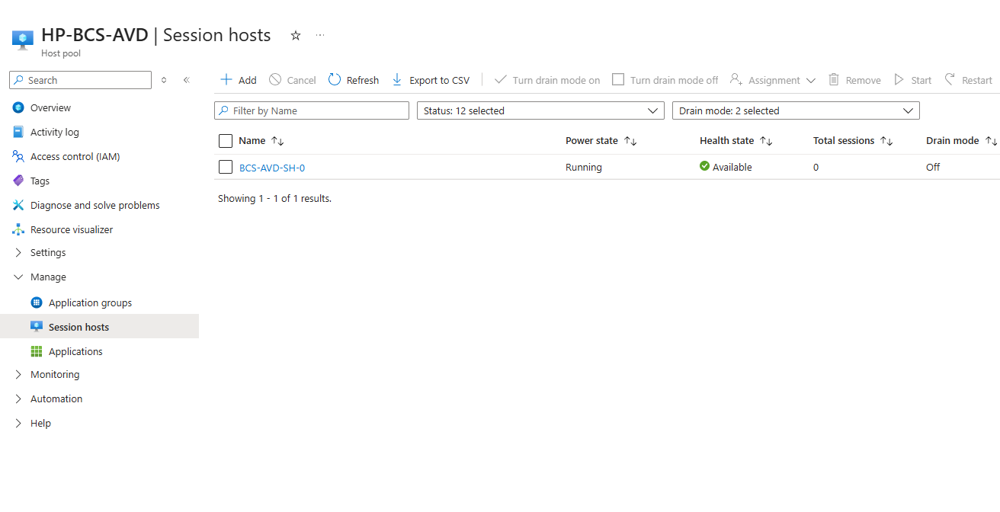
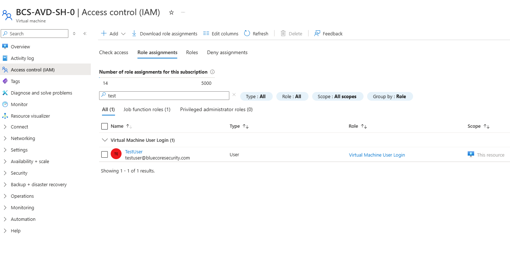
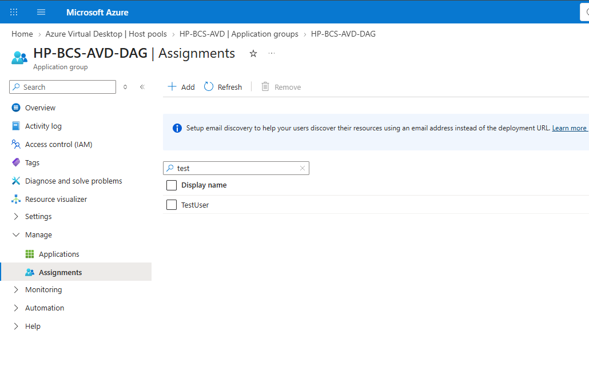
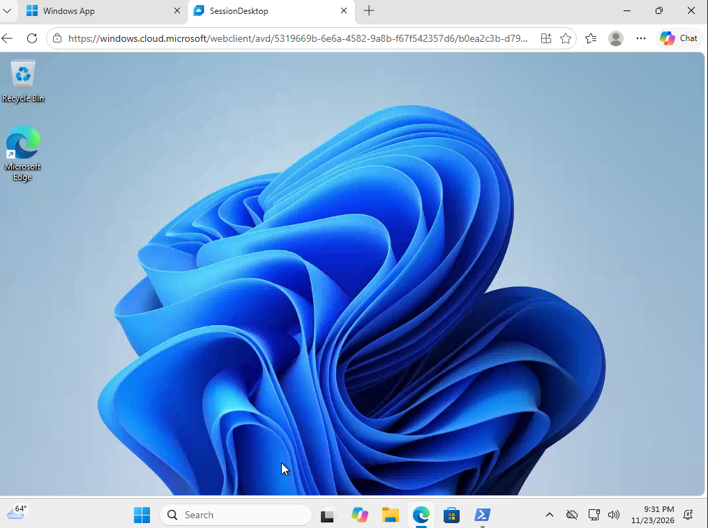

# Azure Virtual Desktop Deployment & Security Implementation

## Project Overview

This project demonstrates the end-to-end deployment and configuration of an Azure Virtual Desktop (AVD) environment within BlueCore Security, a fictional enterprise cloud environment designed for hands-on Microsoft cloud security and infrastructure engineering.

The deployment focuses on cloud-based virtual desktop infrastructure, Microsoft Entra ID authentication, role-based access control (RBAC), Azure Files, and FSLogix profile management.

## Project Objectives

- Deploy a functional Azure Virtual Desktop environment from scratch.
- Configure Azure networking and virtual desktop infrastructure.
- Implement Microsoft Entra ID authentication.
- Configure role-based access control and least-privilege permissions.
- Integrate Azure Files with Microsoft Entra Kerberos.
- Implement FSLogix profile containers.
- Validate multi-user connectivity and profile persistence.
- Troubleshoot authentication, storage, and permission issues.

## Technologies Used

- Microsoft Azure
- Azure Virtual Desktop (AVD)
- Microsoft Entra ID
- Microsoft Entra Kerberos
- Azure Virtual Network
- Azure Files
- Azure RBAC
- FSLogix
- Windows 11
- Windows App
- PowerShell
- RestSetAcls PowerShell Module

## Infrastructure Architecture

| Component | Configuration |
|---|---|
| Resource Group | RG-BCS-AVD-LAB |
| Azure Region | East US |
| Virtual Network | VNET-BCS-AVD |
| Address Space | 10.20.0.0/16 |
| Session Host Subnet | 10.20.1.0/24 |
| Host Pool | HP-BCS-AVD |
| Host Pool Type | Pooled |
| Load Balancing | Breadth-first |
| Maximum Session Limit | 2 |
| Workspace | WS-BCS-AVD |
| Application Group | HP-BCS-AVD-DAG |
| Session Host | BCS-AVD-SH-0 |
| VM Size | Standard D2as v6 |
| Profile Storage | Azure Files |
| Profile Container Format | VHDX |

## 1. Azure Networking and Infrastructure

Created a dedicated Azure resource group, virtual network, and subnet to support the AVD session host infrastructure.

Configured a pooled host pool, workspace, desktop application group, and Windows 11 session host.

Validated session host registration, availability, and connectivity.

## 2. Identity and Access Management

Implemented Microsoft Entra ID authentication for cloud-only identities.

Configured Azure RBAC and application group assignments to authorize users to access the virtual desktop environment.

Security configurations included:

- Virtual Machine User Login permissions.
- Desktop application group assignments.
- Scoped Azure Files permissions.
- Separation of administrative and standard user access.
- Least-privilege access principles.

## 3. Azure Files and Storage Security

Configured an Azure Files SMB share to provide centralized storage for FSLogix profile containers.

Implemented Microsoft Entra Kerberos authentication and restricted storage account network access to selected networks.

Configured share-level RBAC permissions and directory-level access control lists (ACLs).

Default share-level permissions remained disabled to support explicitly authorized access.

## 4. FSLogix Profile Management

Configured FSLogix on the Azure Virtual Desktop session host to provide persistent user profiles.

Implementation included:

- Verification of FSLogix services.
- Configuration of profile container registry settings.
- Azure Files integration using a UNC storage path.
- VHDX profile container configuration.
- Administrative account exclusion from FSLogix profile management.
- Automatic creation of individual user profile containers.

## 5. Troubleshooting and Remediation

Several technical challenges were encountered and investigated during deployment:

| Issue | Resolution |
|---|---|
| Domain controller authentication error | Identified limitations of traditional ACL tools with cloud-only identities. |
| Azure Files authorization errors | Investigated storage networking, RBAC permissions, and authentication context. |
| PowerShell module execution restrictions | Resolved module loading restrictions within the PowerShell session. |
| Cloud-only directory permissions | Used the RestSetAcls PowerShell module to configure Azure Files ACLs through the REST API. |
| AVD user authentication failure | Investigated user authorization and successfully established connectivity. |
| FSLogix profile validation | Verified container creation, active profile redirection, and profile persistence. |

## 6. Deployment Validation

The following functionality was successfully validated:

- Azure Virtual Desktop session host availability.
- Microsoft Entra ID user authentication.
- Virtual desktop connectivity through Windows App.
- Azure Files read and write operations.
- FSLogix VHDX profile creation.
- Active FSLogix profile attachment and redirection.
- User profile persistence across sign-out and sign-in.
- Successful connectivity using multiple test identities.
- Separate FSLogix profile directories for individual users.

Cross-user profile isolation was investigated but was not conclusively validated. Additional permission testing would be required before production deployment.

## 7. Cost Management

Implemented a manual session host shutdown and deallocation workflow to minimize Azure compute costs when the lab is not in use.

The underlying infrastructure and persistent profile storage are retained for future testing and demonstrations.

## Skills Demonstrated

- Azure infrastructure deployment
- Azure Virtual Desktop administration
- Cloud identity and access management
- Role-based access control
- Azure storage security
- Microsoft Entra Kerberos authentication
- FSLogix profile management
- PowerShell administration
- Cloud infrastructure troubleshooting
- Virtual desktop security
- Azure resource cost management

## Project Outcome

Successfully deployed and validated a functional, cloud-based Azure Virtual Desktop environment integrated with Microsoft Entra ID, Azure Files, and FSLogix.

This project demonstrates practical experience deploying virtual desktop infrastructure from scratch, implementing identity-based access controls, configuring persistent user profiles, and troubleshooting cloud infrastructure and authentication issues.

## Lab Environment Disclaimer

BlueCore Security is a fictional enterprise environment created exclusively for technical training, professional development, and portfolio demonstrations. No production client data is used.

## Deployment Screenshots

### 1. Azure Virtual Network and Subnet Configuration

Dedicated network addressing configured for the AVD session host infrastructure.

### 2. Azure Virtual Desktop Host Pool Deployment

Pooled host pool configured with breadth-first load balancing and a maximum session limit of two users.

### 3. Session Host Availability

Successfully deployed and registered session host showing a healthy and available state.

### 4. Azure Role-Based Access Control

Configured Virtual Machine User Login permissions to authorize standard user access to the session host.

### 5. Desktop Application Group Assignment

Configured application group assignments to provide authorized users with access to the published virtual desktop.

### 6. Successful Virtual Desktop Connection

Validated end-user connectivity to the Azure Virtual Desktop environment through Windows App.

