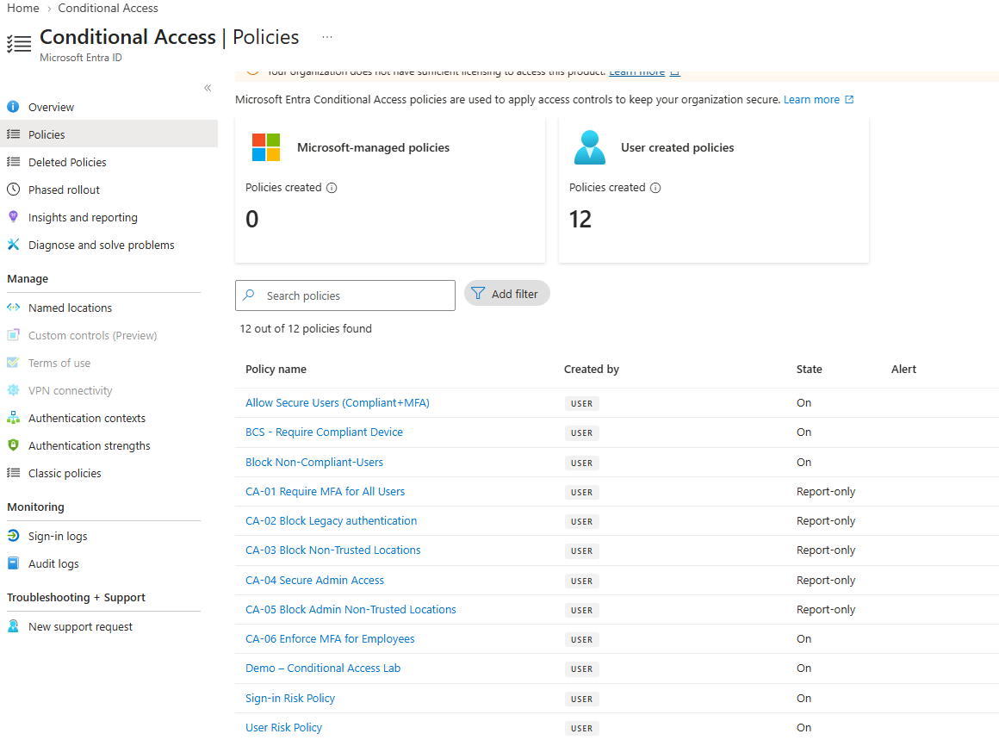
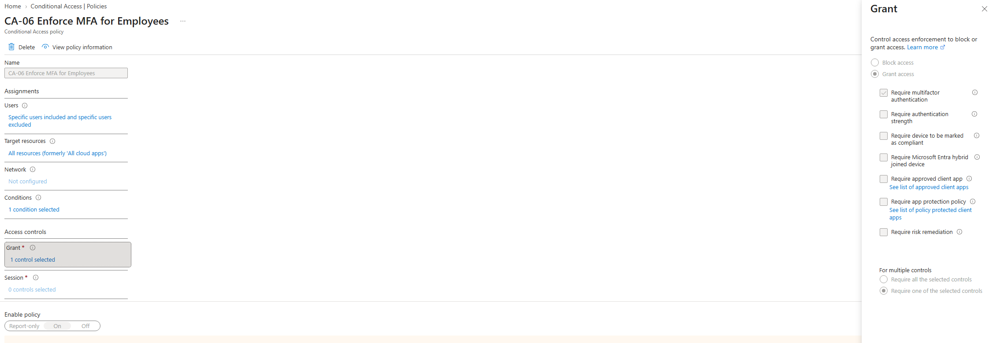
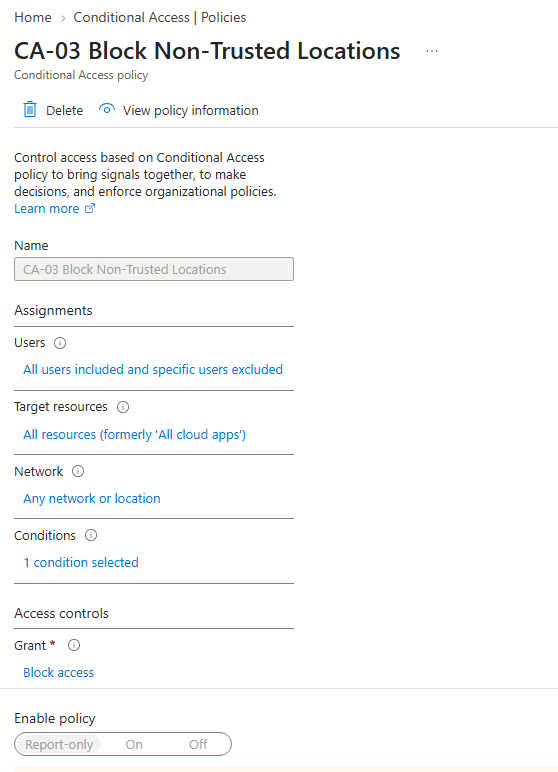
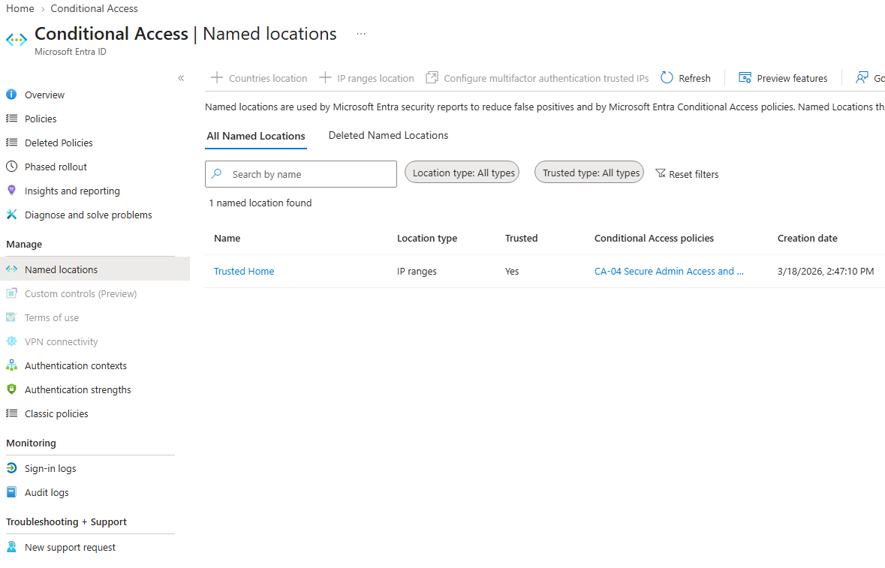
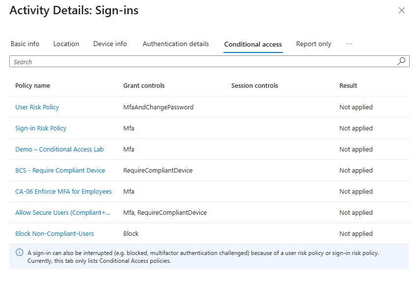

# Microsoft Entra ID Security – Conditional Access & MFA

## Project Objective

Implement and validate Microsoft Entra ID Conditional Access policies to strengthen identity security, enforce multi-factor authentication (MFA), and restrict unauthorized access.

This lab demonstrates how Conditional Access can reduce identity-based security risks while maintaining emergency administrative access.

## Conditional Access Policies Configured

### Policy 1: Require Multi-Factor Authentication (MFA)
- Configured Conditional Access to require MFA for users.
- Excluded emergency access (break-glass) accounts to prevent administrative lockout.

### Policy 2: Restrict Access by Geographic Location
- Configured location-based Conditional Access restrictions.
- Configured a Conditional Access policy to evaluate location-based access restrictions in Report-only mode.
- Used named locations to define geographic access boundaries.

## Policy Validation

Conditional Access policies can be validated using Microsoft Entra ID sign-in logs and the Conditional Access What If tool.

Validation checks include:
- Confirming MFA requirements apply to targeted users.
- Verifying emergency access accounts are excluded.
- Reviewing location-based access restrictions.
- Checking sign-in logs for policy evaluation results.

## Lab Screenshots and Configuration Evidence

The following screenshots document Conditional Access configurations and sign-in analysis performed in a Microsoft Entra ID lab environment.

### 1. Conditional Access Policy Overview

Overview of 12 user-created Conditional Access policies, including MFA, device compliance, location restrictions, and identity risk controls. Policies include both enabled and Report-only configurations.

### 2. Multi-Factor Authentication Policy

Conditional Access policy configured to require MFA for selected users and resources.

### 3. Location-Based Access Restrictions

Conditional Access policy configured to evaluate location-based restrictions in Report-only mode. Trusted-location exclusions were not populated in the captured configuration.

### 4. Named Locations

Configured a trusted IP-based named location for use with Conditional Access policies. Actual IP addresses are excluded from the documentation.

### 5. Conditional Access Sign-in Analysis

Reviewed Microsoft Entra ID sign-in logs to examine Conditional Access policy evaluation. The captured sign-in shows policies marked "Not applied," rather than successful enforcement.

## Lab Environment Notes

This project was completed in a controlled Microsoft Entra ID lab environment. Some policies remain in Report-only mode, and certain functionality may be limited by licensing. Screenshots document configurations and observed results rather than claiming production enforcement.
