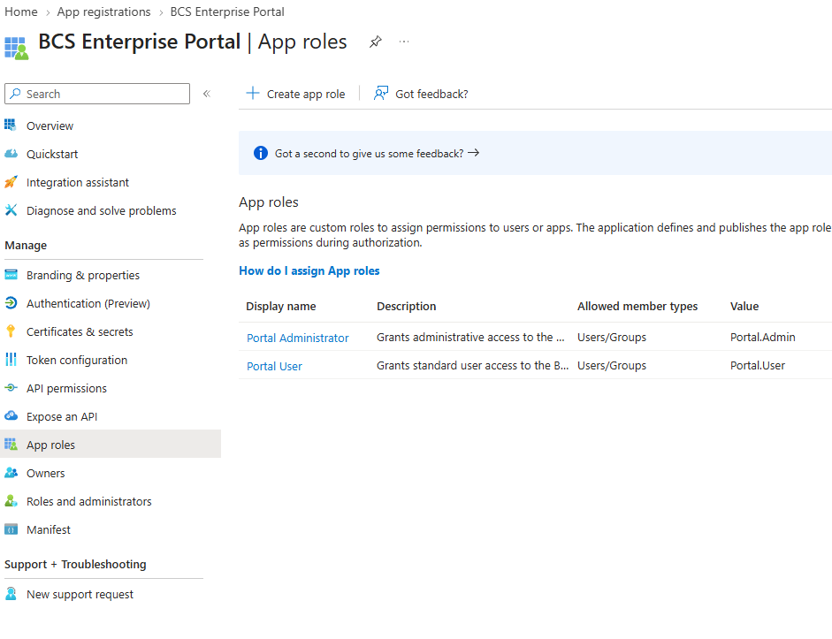
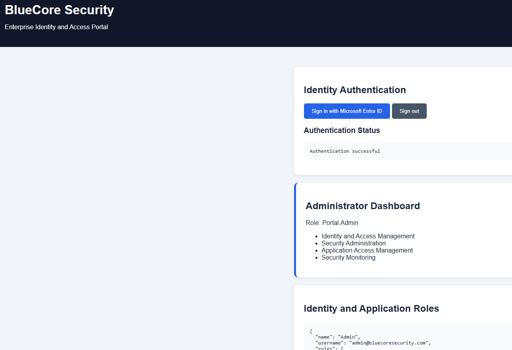
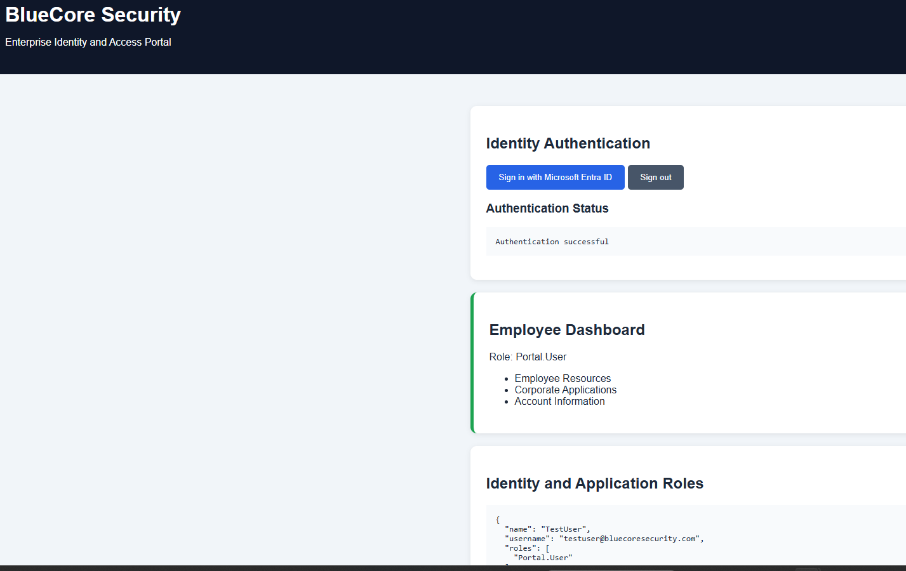
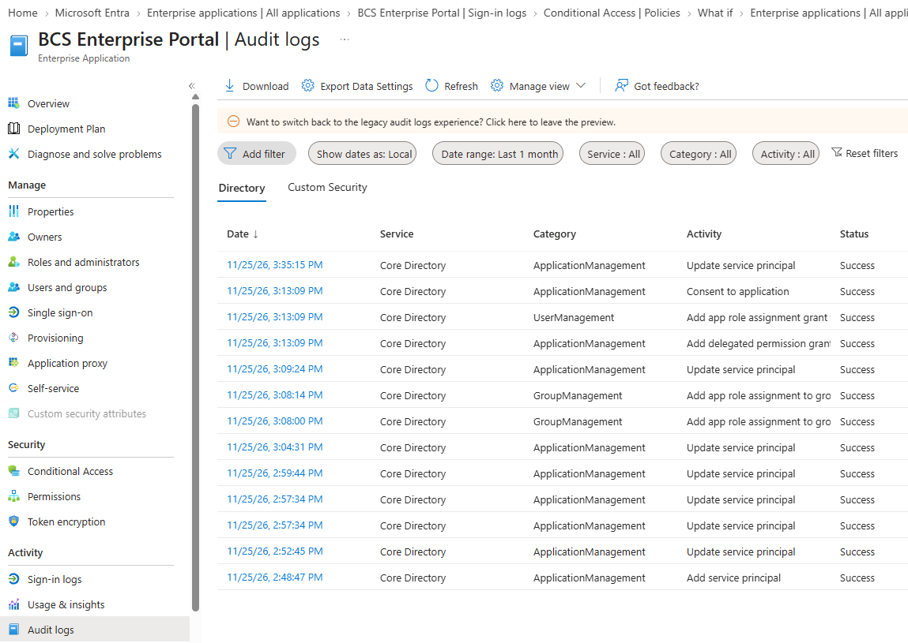
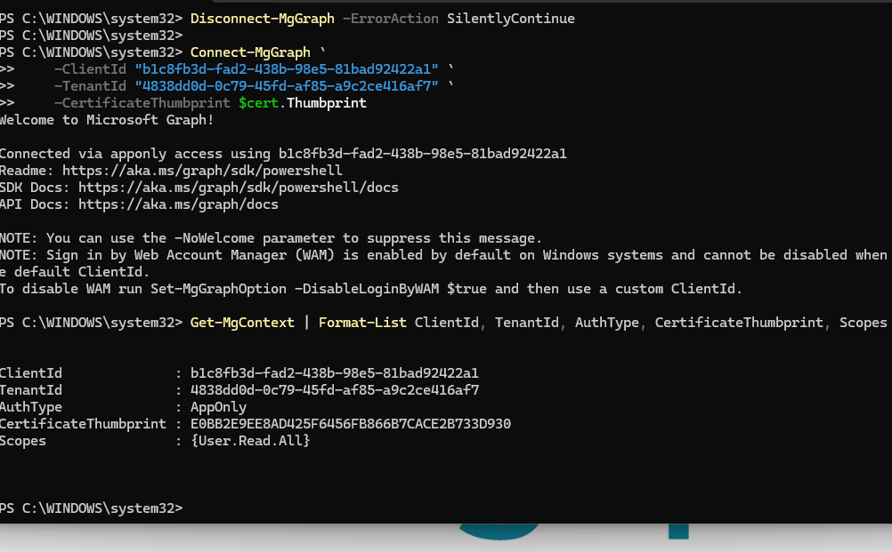
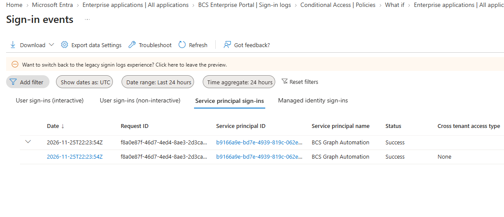
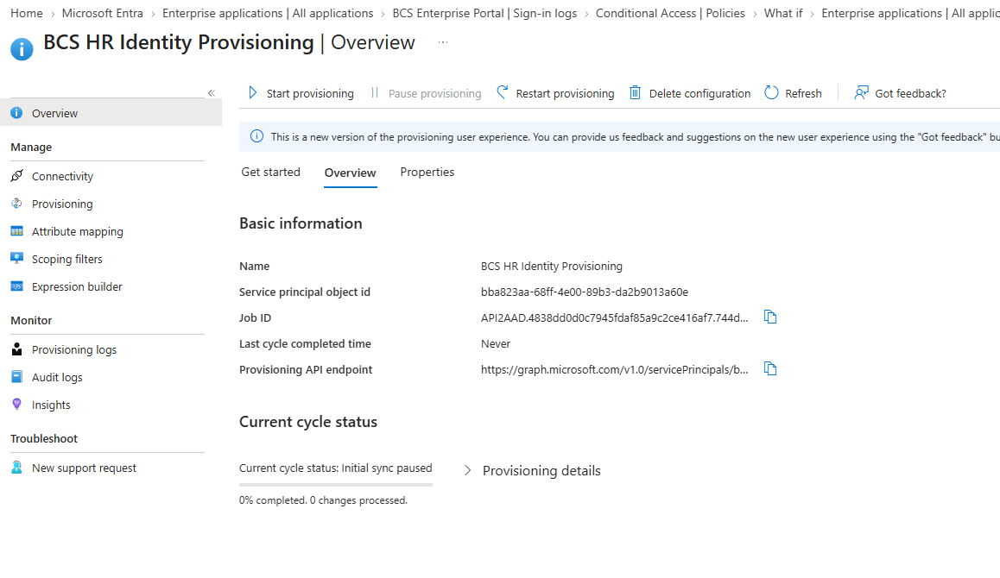
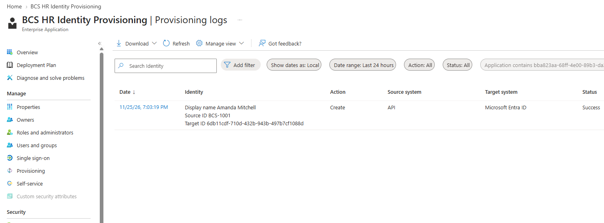
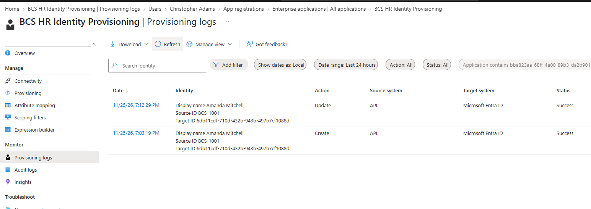
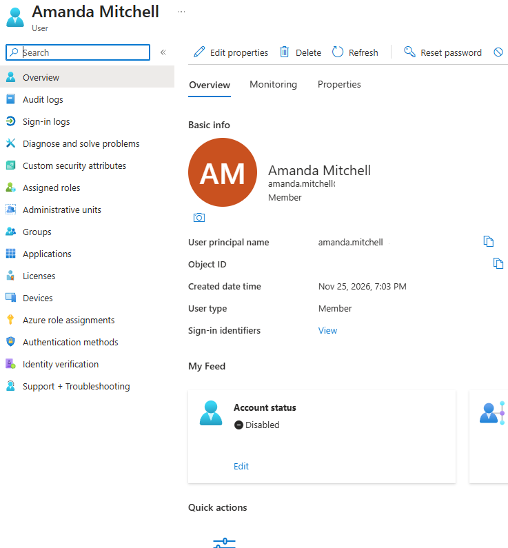

# Microsoft Entra Identity & Application Security

## Project Overview

Implemented an enterprise identity and application security environment within BlueCore Security, a simulated organization designed to demonstrate real-world Microsoft cloud security and identity engineering practices.

This project focuses on enterprise application management, workload identity security, certificate-based authentication, automated identity lifecycle management, and Customer Identity and Access Management (CIAM).

## Project Objectives

- Configure enterprise applications within Microsoft Entra ID.
- Implement secure, certificate-based Microsoft Graph authentication.
- Apply least-privilege application permissions.
- Monitor service principal authentication activity.
- Implement API-driven inbound user provisioning.
- Automate employee onboarding, attribute updates, and offboarding.
- Deploy a dedicated Microsoft Entra External ID tenant.
- Validate customer self-service registration and authentication.

## Technologies Used

- Microsoft Entra ID
- Microsoft Entra External ID
- Microsoft Graph API
- Microsoft Graph PowerShell
- Enterprise Applications
- App Registrations
- Service Principals
- Conditional Access
- X.509 Certificates
- SCIM 2.0
- OAuth 2.0
- OpenID Connect (OIDC)
- Proof Key for Code Exchange (PKCE)

## 1. Enterprise Application Management

Configured the BCS Enterprise Portal within Microsoft Entra ID to demonstrate centralized enterprise application management and identity-based access controls.

Reviewed application configuration, Conditional Access integration, and application monitoring capabilities.

## 2. Workload Identity Security

Implemented certificate-based application authentication using the BCS Graph Automation app registration.

Configuration included:

- Microsoft Entra application registration.
- Certificate-based authentication.
- Microsoft Graph application permissions.
- Administrator consent.
- Non-interactive, app-only authentication.
- Service principal sign-in monitoring.

Successfully authenticated to Microsoft Graph PowerShell without interactive user credentials and validated directory read operations.

## 3. API-Driven Identity Provisioning

Implemented the BCS HR Identity Provisioning enterprise application to simulate integration between an external HR system and Microsoft Entra ID.

Configuration included:

- API-driven inbound provisioning.
- SCIM-based JSON payloads.
- Microsoft Graph bulkUpload API.
- Source-to-target attribute mappings.
- Employee ID matching.
- Application-based provisioning permissions.
- Provisioning activity monitoring.

The provisioning workflow used Microsoft Graph PowerShell to submit simulated HR identity data to Microsoft Entra ID.

## 4. Employee Identity Lifecycle Management

Validated employee identity lifecycle operations using a fictional BlueCore Security employee.

### Onboarding

- Submitted employee identity data through the provisioning API.
- Automatically created an employee account in Microsoft Entra ID.
- Verified account creation through provisioning logs.

### Employee Updates

- Submitted updated employee information through the provisioning API.
- Tested automated identity attribute updates.

### Offboarding

- Submitted an inactive employee status through the provisioning API.
- Verified that the employee account was disabled in Microsoft Entra ID.

This workflow demonstrates the Joiner-Mover-Leaver (JML) identity lifecycle model.

## 5. Customer Identity and Access Management (CIAM)

Deployed a separate Microsoft Entra External ID tenant named BlueCore Customers to isolate customer identities from internal workforce identities.

Configuration included:

- Dedicated External ID tenant.
- BCS Customer Portal application registration.
- Customer sign-up and sign-in user flow.
- Email and password authentication.
- Customer attribute collection.
- Application association.
- OAuth 2.0 authorization code flow.
- PKCE using the S256 challenge method.

Successfully validated customer self-service registration, customer account creation, and returning customer authentication.

## Validation and Testing

| Validation | Result |
|---|---|
| Certificate-based Graph authentication | Successful |
| Microsoft Graph directory read operations | Successful |
| Service principal authentication | Successful |
| API-driven provisioning request | Accepted |
| Automated employee account creation | Successful |
| Employee attribute update request | Submitted |
| Automated employee account disablement | Successful |
| Customer self-service registration | Successful |
| Customer account creation | Successful |
| Returning customer authentication | Successful |
| OAuth 2.0 authorization code issuance | Successful |

## Skills Demonstrated

- Identity and Access Management (IAM)
- Customer Identity and Access Management (CIAM)
- Workload identity security
- Enterprise application administration
- Application permission management
- Certificate-based authentication
- Identity lifecycle automation
- Microsoft Graph API integration
- SCIM-based identity provisioning
- OAuth 2.0 and OpenID Connect
- Identity security monitoring
- Provisioning log analysis
- PowerShell automation

## Project Outcome

Successfully implemented and validated core enterprise identity engineering workflows across workforce and customer identity environments.

The project demonstrates secure application authentication, automated employee identity provisioning, identity lifecycle management, and customer authentication using Microsoft Entra technologies.

## Screenshots

### Enterprise Application Role Management

### OIDC Administrator Authentication

### OIDC Employee Authentication

### Application Security Audit Logs

### Certificate-Based App-Only Authentication

### Service Principal Sign-In Monitoring

### API-Driven Identity Provisioning Configuration

### Automated Employee Onboarding

### Automated Employee Transfer

### Automated Employee Offboarding

## Lab Environment Disclaimer

This project was implemented in a controlled Microsoft cloud lab environment using fictional organizations, employees, and customer identities.

SCIM-based provisioning was implemented through Microsoft's native API-driven inbound provisioning service rather than a custom outbound SCIM server.

Customer authentication was validated through authorization code issuance. Full application integration, authorization code redemption, and token validation were outside the scope of this project.
